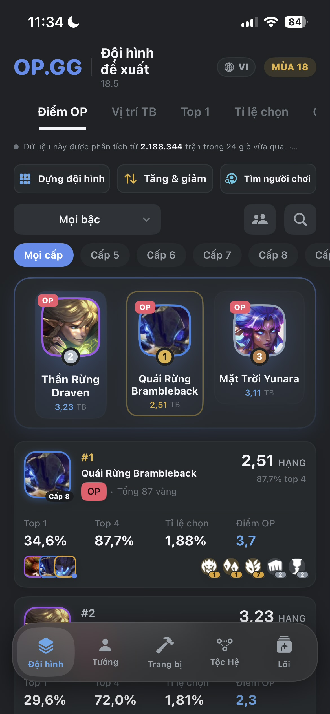
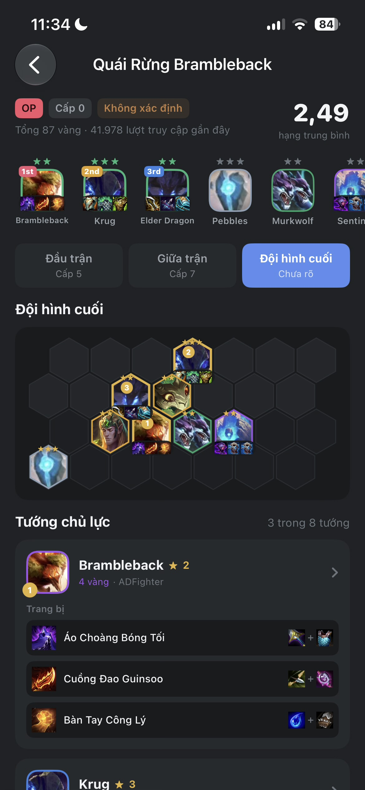
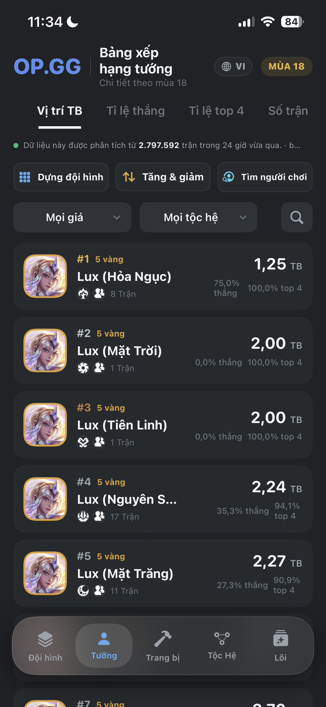
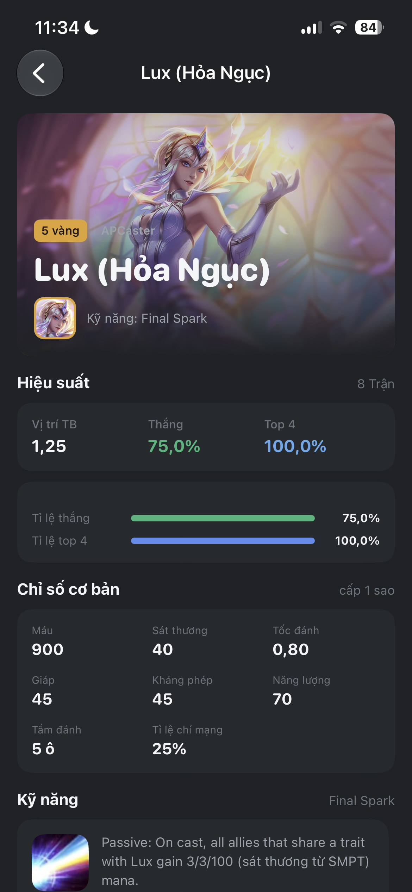
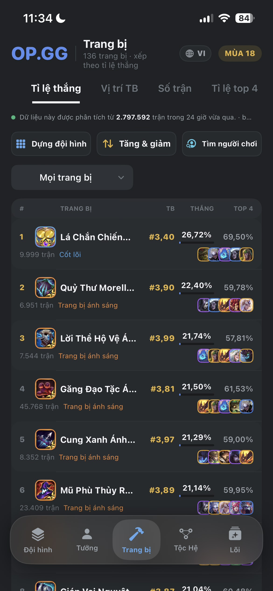
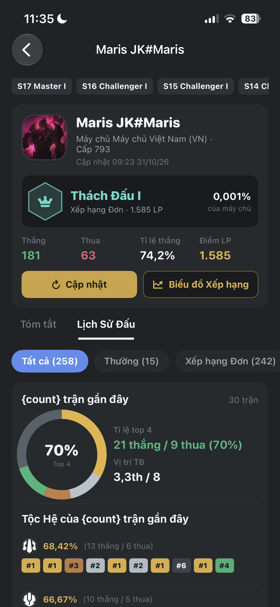
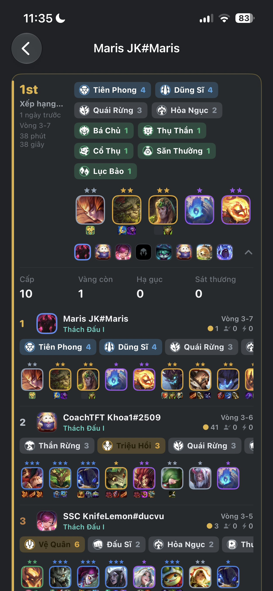

# TFT Meta

A native iOS application for Teamfight Tactics players, delivering real-time meta analysis, team composition insights, and player statistics. Built with SwiftUI, designed to match the OP.GG mobile experience.

## Overview

TFT Meta provides comprehensive data analysis for Teamfight Tactics Set 18, pulling from over 2.7 million matches analyzed in the last 24 hours. The app presents win rates, pick rates, average placements, and top-4 rates across all champions, items, traits, and augments.

The interface follows a five-tab structure: Compositions, Champions, Items, Traits, and Augments. Each tab offers sortable, filterable views with detailed breakdowns available through navigation.

## Features

### Team Compositions

The Compositions tab displays ranked team builds sorted by OP Score, win rate, average placement, or pick rate. Each composition card shows the core units, trait activations, and performance metrics.



The podium section highlights the top three compositions with visual emphasis on their rankings. Below, a scrollable list presents all compositions with their stats.

Tapping a composition opens the detail view, which includes a hex board visualization showing unit positions, stage-by-stage progression (early game at level 5, mid game at level 7, final composition), core unit breakdowns with item builds, trait activations, and similar compositions.



The hex board renders the actual 3x7 TFT board layout with units placed in their optimal positions. Core units are highlighted with gold borders and priority badges. Items appear beneath each unit.

### Champions

The Champions tab ranks all champions by average placement, win rate, top-4 rate, or games played. Filters allow narrowing by cost tier and trait.



Each champion row displays the champion art, name with skin variant, cost tier, trait icons, and performance statistics. The average placement is prominently shown on the right.

The champion detail view provides a full breakdown: performance metrics (average placement, win rate, top-4 rate), base stats (HP, damage, attack speed, armor, magic resist, mana, range, crit chance), ability description, item usage rankings, and composition appearances.



### Items

The Items tab ranks items by win rate, average placement, games played, or top-4 rate. Each item row shows the item icon, name, category tag, average placement, win rate, top-4 rate, and a strip of champion thumbnails representing the top performers with that item.



Item categories include Core, Radiant, Artifact, Emblem, and Component. The detail view shows the item's stat description, build formula with component arrows, associated traits, best champion pairings, and alternative combinations.

### Traits

The Traits tab displays all synergies ranked by win rate. Each trait shows its icon, name, type, activation tier ladder, and headline statistics. The detail view breaks down performance by tier, lists compositions using the trait, and shows champion contributions.

### Augments

The Augments tab lists all augment options sorted by OP tier, name, or rarity tier (Prismatic, Gold, Silver). Each row shows the augment icon, name, description, OP tier badge, and rarity label.

The detail view includes the full effect text, associated traits, incompatible traits, compositions that use the augment, same-tier alternatives, and synergy suggestions based on shared trait associations.

### Summoner Search

The summoner search feature looks up players by name and tag, displaying their rank, LP, win/loss record, and recent match history.



The profile shows seasonal ranks across multiple sets, current tier and division, LP points, and percentile ranking. The recent form card displays top-4 rate, average placement, and win/loss counts over the last 30 games.



Match history entries show placement, round eliminated, traits activated, units on board with items, and final stats (level, gold remaining, damage dealt).

### Team Builder

The Team Builder tool lets players construct compositions on a hex board. Champions can be dragged from the tray onto the board, items can be assigned to units, and augments can be selected. The board displays real-time trait activations, average cost, and gold spent.

Units on the board can be dragged to swap positions. The overlay toggle switches between showing win rates, position frequency, or no overlay on each hex.

### Buffs and Nerfs

The balance changes view lists all champion, trait, item, and augment adjustments in the current patch. Changes are categorized as buffs, nerfs, or adjustments with before/after stat comparisons.

## Technical Details

### Architecture

The app follows a single-source-of-truth pattern with an `ObservableObject` repository managing language, theme, dataset, and live data state. Views observe the repository through `@EnvironmentObject` and re-render when relevant properties change.

Data flows from bundled JSON files (one per language) for the initial load, with live fetching from OP.GG's meta trends pages on refresh. The flight payload extraction parses server-rendered HTML to extract the JSON data embedded in the page.

### Localization

Four languages are supported: Vietnamese, English, Korean, and Japanese. The localization system uses a JSON-based key-value store with pluralization support. Language switching reloads the entire dataset from the corresponding bundled file and clears all cached live data.

### Design System

The color palette is sampled from the OP.GG mobile reference. All colors are defined in a static `Theme` enum with semantic names (background, surface, textPrimary, accent, gold, etc.). The design uses rounded corners (14pt for cards, 9pt for chips), consistent 16pt gutters, and a dark-only theme.

Custom components include:
- `HexBoard` and `HexGeometry` for rendering the TFT board layout
- `RemoteImage` with caching and prefetching
- `Card`, `Chip`, `StatColumn`, `MeterBar` for data display
- `PressStyle` button style with haptic feedback
- `CustomRefreshable` with pull-to-refresh animation

### Data Model

The dataset contains references (champions, items, traits, augments) and statistics (compositions, champion stats, item stats, augment stats). References are language-specific with localized names and descriptions. Statistics are universal across languages.

Position data (per-hex win rates and pick rates for each champion) is bundled separately and loaded based on the selected language.

## Project Structure

```
App/
  Data/           Repository, live fetching, flight extraction
  DesignSystem/   Theme, components, hex board, haptics
  Features/       One folder per tab: Comps, Champions, Items, Traits, Augments
  Models/         Data structures: TFTData, Summoner, Balance
  Resources/      Bundled JSON datasets, i18n strings
CompWidget/       Home screen widget showing top compositions
```

## Requirements

- iOS 17.0 or later
- Xcode 15.0 or later
- Swift 5.9 or later

## Building

Open `TFTMeta.xcodeproj` in Xcode and build for the iOS Simulator or a physical device. The project has no external dependencies.

```
xcodebuild -project TFTMeta.xcodeproj -scheme TFTMeta -destination 'platform=iOS Simulator,name=iPhone 16' build
```

## License

This project is for educational purposes. Teamfight Tactics and all related assets are property of Riot Games. OP.GG is a third-party service.
